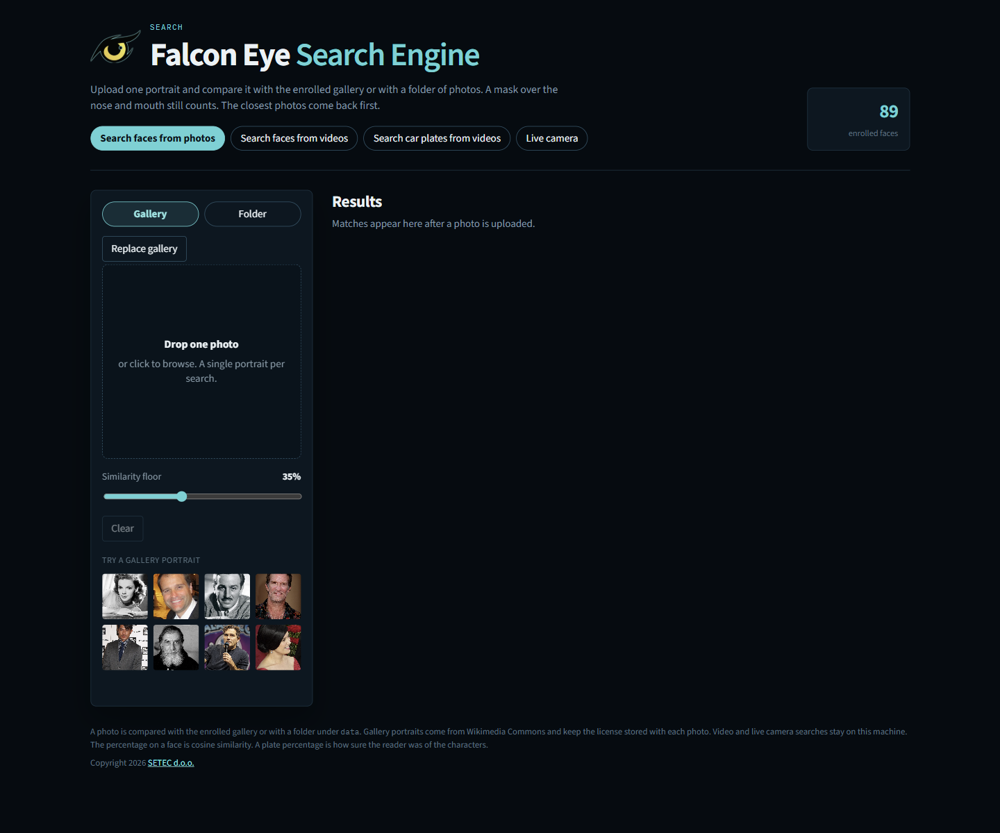
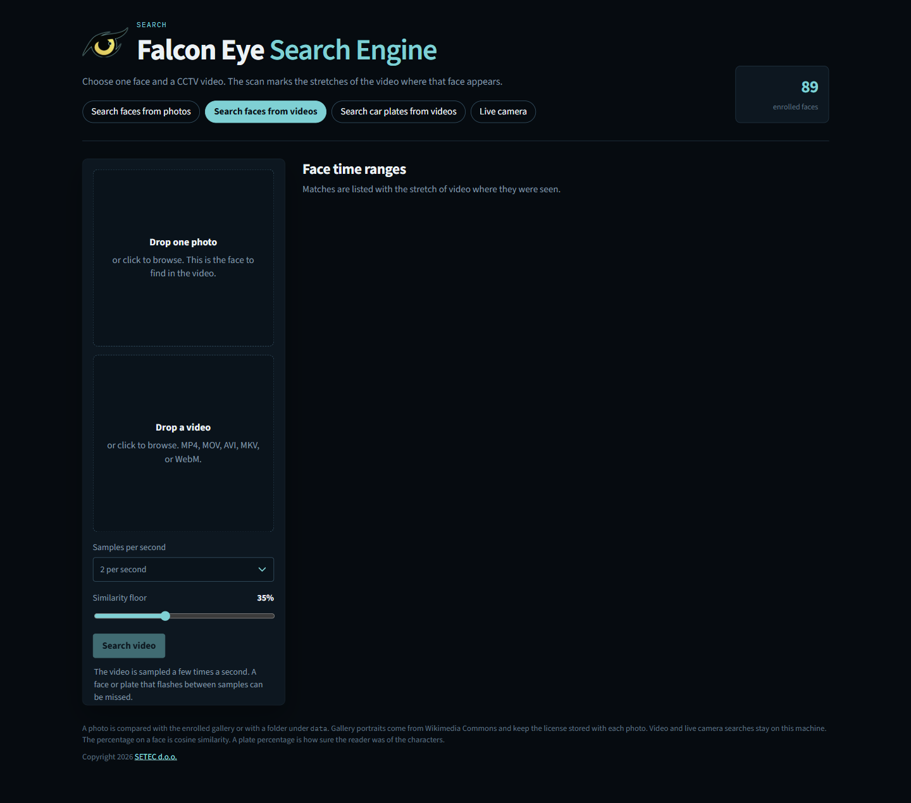
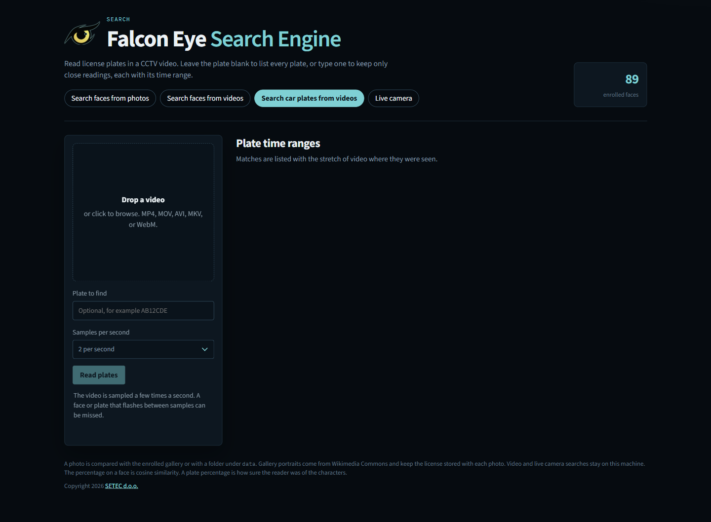
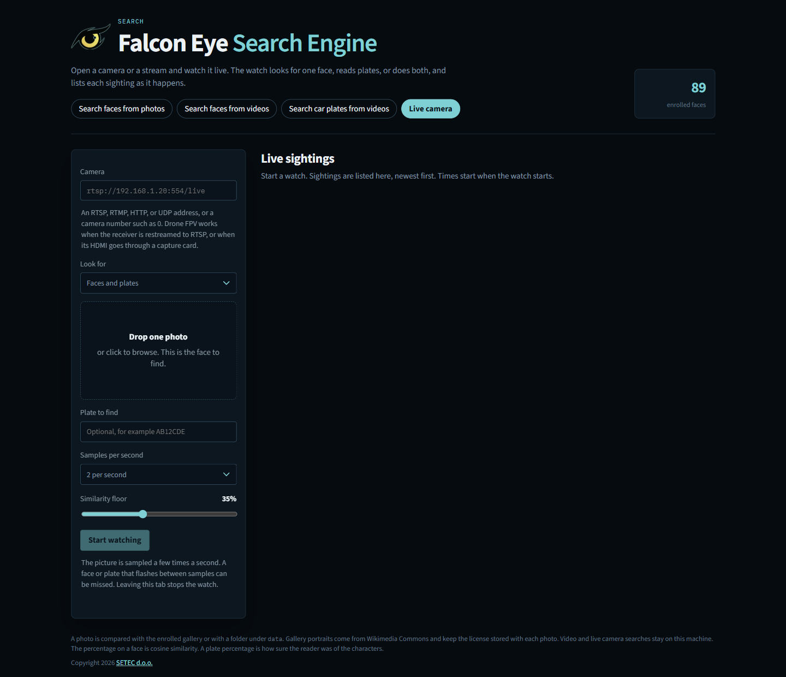

# Falcon Eye Search Engine

Falcon Eye Search Engine matches **one uploaded portrait** against a gallery of enrolled faces. The gallery is built ahead of time. A search detects the face in the upload, turns it into a recognition embedding, and returns every gallery photo at or above a similarity floor, strongest first, in pages.

A mask over the nose and mouth is a normal case. The detector still finds the face from the eyes, brows, and head shape. The similarity score is lower than a clear-to-clear match, so lower the similarity floor when the upload is masked.

## Screens

Search faces from photos. One portrait is compared with the enrolled gallery, or with a folder of photos.



Search faces from videos. One face is marked across the stretches of a video where it appears.



Search car plates from videos. License plates are read from a video and listed with the time range for each reading.



Live camera. A camera or a stream is watched for one face, for plates, or for both.



## Quick start

Docker Desktop must be running.

```bash
docker compose up -d --build
```

- App: http://localhost:9080
- API docs: http://localhost:9081/api/docs

Host ports are 9080 and 9081 because Windows often reserves 8000 and 8080. Inside Docker the API still listens on port 8000.

The `importer` service starts with the stack and enrolls up to 20,000 portraits. The site is usable as soon as the first faces are stored. Watch progress with:

```bash
docker compose logs -f importer
```

The gallery is the SQLite file `data/faces.db`. There is no database password.

## What happens on one upload

1. The browser sends one image to `POST /api/search`.
2. The API checks the type and size (10 MB), then decodes the image.
3. InsightFace `buffalo_l` finds faces. The largest face that is at least 48 pixels on each side is kept. SCRFD, the detector inside this model, still returns a box when the nose and mouth are covered.
4. That face becomes one 512-number embedding. The numbers are L2-normalized.
5. The embedding is saved under a search id for one day, so later pages do not upload or re-detect the photo.
6. SQLite compares it with every enrolled embedding and returns one page of faces at or above the similarity floor.

Photo files are not compared to each other. Only the embeddings are.

## Two different identifiers

| | File SHA-1 | Recognition embedding |
|---|---|---|
| What it is | SHA-1 of the stored JPEG bytes | 512 floats from the recognition model |
| Where it lives | File name `data/photos/{sha1}.jpg` and column `faces.file_sha1` | Column `faces.embedding` (`vector(512)`) |
| What it is for | Store the file once, and serve it back with `GET /api/photos/{sha1}` | Find similar faces with cosine similarity |
| Changes when | The JPEG bytes change | The face crop or the recognition model changes |

The percentage in the UI is `cosine similarity × 100`, rounded to one decimal. It is not a probability and it is not a comparison of the SHA-1 values. The same JPEG enrolled in the gallery and uploaded again scores about 100%. A different photo of the same person scores lower. A mask lowers it further. Two different people usually land well below a clear match.

Default floor is 35%. Move it down to walk further through lookalikes. At 0% the API returns gallery faces with cosine similarity of at least 0, still ranked.

## Repository

```
LICENSE                     Noncommercial license for this application
docker-compose.yml          API, web, importer
backend/
  Dockerfile                Python image, InsightFace model baked in
  requirements.txt
  app/main.py               HTTP API
  app/face_engine.py        Detect and embed faces
  app/scan_folder.py        Index a folder and search it
  app/scan_video.py         Face and plate scans over a video
  app/live.py               Live camera and stream watch
  app/plate_engine.py       License-plate detector and OCR
  app/db.py                 Schema, search, paging
  app/importer.py           Wikimedia Commons demo import
  app/config.py             Environment settings
  app/schemas.py            Response models
frontend/
  Dockerfile                Vue build, then nginx
  nginx.conf                Serves the app and proxies /api
  src/App.vue               Tabs: photos, video faces, video plates, live camera
  src/api.js                Calls the API
data/photos/                Gallery JPEGs, named by SHA-1. Created at runtime.
data/sources/               Folders uploaded from the browser.
data/jobs/                  Video scans and their snapshot frames.
```

## Services

`docker-compose.yml` starts three services on one network.

| Service | Image | Role | Port |
|---|---|---|---|
| `api` | built from `backend/` | FastAPI face search | http://localhost:9081 |
| `web` | built from `frontend/` | Vue app via nginx | http://localhost:9080 |
| `importer` | same image as `api` | Downloads and enrolls the demo gallery | none |

The `data` directory is a bind mount at `/data`. The gallery database is `data/faces.db`. Gallery JPEGs stay in `data/photos`. Put another folder of images next to `photos` and choose it in the Folder search. Video scans and uploaded folders are stored under `data/jobs` and `data/sources`.

The API loads the face model once at startup and keeps a single ONNX session. Recognition runs in a worker thread, one call at a time, so the event loop can keep serving photos and later pages while a search is in progress. Folder indexing, video scans, and a live camera share one queue so they do not run two heavy jobs at once. A live watch holds that queue until it stops. Run one API process per container.

The importer does not restart after it exits. Resume a stopped import with:

```bash
docker compose up -d importer
```

It skips people already enrolled or already rejected.

## Database

The gallery is one SQLite file, `data/faces.db`. Embeddings are 512-float blobs. [sqlite-vec](https://github.com/asg017/sqlite-vec) computes cosine distance, and a search keeps every face at or above the similarity floor. One hundred thousand faces is about 200 MB of embeddings. Scanning them is a few tens of milliseconds. The time you feel is still the detection of the uploaded face. An older Postgres volume is not copied into this file. Run the importer again to enroll the demo set.

Tables, created by the API on startup:

- `faces` — one enrolled portrait. `file_sha1` is unique. `wikidata_id` is unique so the demo keeps one photo per person. `embedding` is 512 float32 numbers.
- `folder_files` — faces indexed from a chosen folder. The key is the folder path, the file path, and the face number in that image. Unchanged files are not embedded again. Gallery files whose name is already a SHA-1 reuse the enrolled embedding.
- `searches` — the embedding for an upload, kept for 24 hours so paging does not repeat detection. Old rows are deleted when a new search is created.
- `import_skips` — Wikidata ids that were rejected (no face, too small, not an image, download failed) so a resume does not fetch them again.
- `gallery_meta` — the model name and embedding size used to build the gallery. Startup refuses to search if those do not match the running model and the gallery is not empty.

Useful checks:

```bash
docker compose exec api python -c "import sqlite3; c=sqlite3.connect('/data/faces.db'); print(c.execute('select count(*) from faces').fetchone()[0])"
docker compose exec api python -c "import sqlite3; c=sqlite3.connect('/data/faces.db'); [print(row) for row in c.execute('select person_name, file_sha1 from faces order by id desc limit 5')]"
```

Reset enrolled faces and delete the JPEGs:

```bash
docker compose run --rm importer python -m app.importer --reset --target 20000
```

Deleting `data/faces.db` drops the gallery rows. It does not delete `data/photos`. Remove those files yourself if you want an empty folder.

## API

Interactive schema: http://localhost:8000/api/docs

Base URL through the site is `http://localhost:9080/api`. The API is also published on port 9081.

### `GET /api/health`

Database check for Docker. `200` with `status`, `enrolled_faces`, and `model_name`. `503` if the gallery file cannot be opened.

### `GET /api/stats`

`enrolled_faces`, `model_name`, `embedding_dim`, `det_size`. The page polls this while the import is running.

### `GET /api/samples?limit=8`

Random enrolled portraits so the UI can run a search without a local file. `limit` is 1–24.

### `POST /api/search`

Multipart field `file`: one image. Query parameters:

| Parameter | Default | Range |
|---|---|---|
| `page` | 1 | 1–100000 |
| `page_size` | 12 | 1–60 |
| `min_similarity` | 0.35 | 0–1 |

Limits: image content type, 10 MB, and a readable picture. `422` if no usable face is found. `413` if the file is too large.

```bash
curl -F "file=@portrait.jpg" "http://localhost:9080/api/search?min_similarity=0.35&page=1&page_size=12"
```

```json
{
  "search_id": "c0ffee00-0000-4000-8000-000000000000",
  "page": 1,
  "page_size": 12,
  "total": 37,
  "pages": 4,
  "has_previous": false,
  "has_next": true,
  "min_similarity": 0.35,
  "faces_found": 1,
  "face_box": [0.31, 0.12, 0.68, 0.61],
  "results": [
    {
      "person_name": "Example Person",
      "file_sha1": "0123456789abcdef0123456789abcdef01234567",
      "similarity": 0.872,
      "match_percent": 87.2,
      "photo_url": "/api/photos/0123456789abcdef0123456789abcdef01234567",
      "source_url": "https://commons.wikimedia.org/wiki/File:Example.jpg",
      "author": "Photographer",
      "license": "CC BY-SA 4.0",
      "license_url": "https://creativecommons.org/licenses/by-sa/4.0",
      "wikidata_url": "https://www.wikidata.org/wiki/Q42"
    }
  ]
}
```

`face_box` is `x1, y1, x2, y2` as fractions of the image width and height. `total` counts every gallery face at or above the floor, not just this page.

### `GET /api/search/{search_id}`

Same query parameters and the same response. Use this for page 2 and for a new floor. The upload is not sent again. `404` after the search is older than a day or the id is unknown.

### `GET /api/photos/{file_sha1}`

Returns the JPEG for a 40-character lowercase SHA-1. Anything else is `404`. The response is cached as immutable because the name is the content hash.

## Folder, video, and plates

These three searches are separate from the enrolled gallery. They run as jobs: the upload returns immediately, and the page polls `GET /api/jobs/{job_id}` until `status` is `done` or `error`.

### Folder of images

Put the folder inside `data/` (for example `data/cctv-stills`) and choose it in the Folder tab. The API only reads paths under `/data`. A smaller folder can instead be uploaded from the browser; it is stored under `data/sources/`.

`GET /api/folders?path=` lists the subfolders of a path relative to `data` and counts images, including images in subfolders.

`POST /api/folder-search` takes multipart fields `file` (the face to find) and `folder` (the path under `data`, empty for the data root). Query `min_similarity` defaults to 0.35.

Each image contributes every face that is at least 48 pixels on a side. The first search embeds those faces and stores them in `folder_files`. A later search of the same files only embeds what changed. The job result lists the strongest matches, up to 120, with `photo_url` pointing at `GET /api/media?path=`.

### Face in a CCTV video

`POST /api/video/face` takes multipart fields `file` (the face) and `video` (mp4, mov, avi, mkv, or webm, up to 2 GB). Query `sample_fps` is 0.5–5 and defaults to 2. Query `min_similarity` defaults to 0.35.

The scan keeps a frame a few times per second, finds every face in that frame, and compares it with the uploaded face. Hits that sit close together in time become one range. Each range has `start_label`, `end_label`, the match percentage, and a snapshot with the face marked. A face that appears only between samples can be missed. Frames are reduced so the long side is at most 1600 pixels, so a very small face in a 4K frame can also be missed.

### License plates

Plates are their own search, not a face search. `POST /api/video/plates` takes the video and an optional form field `plate`. With a plate, only readings that match it or differ by one character are kept. With the field blank, every plate that was read is returned, grouped into time ranges the same way.

The reader is FastALPR (a small ONNX detector plus an OCR model), baked into the API image. The percentage on a plate is the reader's confidence, not a face similarity. This does not look the plate up in a registration database. It only reports the text it read and when in the video that text appeared.

### Live camera

`POST /api/live` watches a camera or a network stream instead of a file. The body is multipart:

| Field | Required | Meaning |
|---|---|---|
| `source` | yes | An `rtsp`, `rtsps`, `rtmp`, `rtmps`, `http`, `https`, `udp`, or `tcp` URL, or a camera number `0`–`16` (`camera:0` is the same as `0`) |
| `watch` | no | `faces`, `plates`, or `both`. Default `both` |
| `file` | when watching faces | The face to find. Same limits as a photo search |
| `plate` | no | Keep readings that match this text or differ by one character. Blank lists every plate |

Query `sample_fps` is 0.5–5 and defaults to 2. Query `min_similarity` defaults to 0.35 and applies to faces. The call returns immediately with a `session_id`. Poll `GET /api/live/{session_id}` about once a second. `status` is `starting`, `live`, `stopped`, or `error`. Hits use the same shape as a video time range, plus `kind` (`face` or `plate`). Times are seconds since the watch started. `GET /api/live/{session_id}/preview` is the latest JPEG (`preview_rev` on the status changes when a new one is ready). `POST /api/live/{session_id}/stop` ends it. `GET /api/live/current` is the watch still in memory, or `404`.

One watch runs at a time. Starting another stops the previous one. The watch also stops when the stream has been down through three attempts, when you stop it, or after four hours. Frames are reduced the same way as a video, so a small face or plate can be missed. A password in the URL is used to open the stream and is not returned in `source`.

A network address has to be reachable from the API container. Docker on a desktop can open an RTSP camera on the LAN. A webcam or HDMI capture card is a camera number only when that device is visible inside the container. Typing `0` on Docker Desktop for Windows fails with "No camera with that number was found", because the webcam stays on Windows. Drone FPV is the same idea: the goggles are not a URL until the receiver is restreamed or its HDMI goes through a capture card.

On a Linux host the device can be passed through with:

```yaml
services:
  api:
    devices:
      - /dev/video0:/dev/video0
```

### Laptop camera on Docker Desktop

Publish the webcam on Windows, then give the Live camera tab `rtsp://host.docker.internal:8554/cam`. `host.docker.internal` is the Windows machine as seen from the container. Restarting Docker does not make a camera number work.

ffmpeg's own RTSP listen (`-rtsp_flags listen` or `?listen=1`) does not open the port on Windows. The API then reports "That camera could not be opened" with `Connection refused` in the log. Run [MediaMTX](https://github.com/bluenviron/mediamtx) as the listener and have ffmpeg publish into it.

Windows reserves some TCP ports (Hyper-V). MediaMTX exits if it cannot bind RTMP on 1935. Set `rtmp: false` in `mediamtx.yml` and leave RTSP on `:8554`.

Find the camera name:

```powershell
ffmpeg -list_devices true -f dshow -i dummy
```

Start MediaMTX, then publish. A keyframe every second matters: the default GOP is several seconds long, and the API gives up on a read after 5 seconds.

```powershell
ffmpeg -f dshow -rtbufsize 50M -i video="USB2.0 FHD UVC WebCam" -an -r 15 -c:v libx264 -preset ultrafast -tune zerolatency -pix_fmt yuv420p -g 15 -keyint_min 15 -sc_threshold 0 -f rtsp -rtsp_transport tcp rtsp://127.0.0.1:8554/cam
```

Use the name from the device list in place of `USB2.0 FHD UVC WebCam`. Leave both programs running. Windows must allow desktop apps to use the camera. If the next error is a timeout instead of "connection refused", allow inbound TCP 8554 from the Docker network.

`GET /api/media?path=` serves folder images and the snapshot frames. The path has to stay inside `data`.

## Frontend

The Vue app has four tabs.

- **Search faces from photos** drops or browses one photo and searches the enrolled gallery, or a folder under `data`. The brass rectangle is the face that was embedded. Cards show the person, the match percentage, and the Commons credit. Paging and the similarity floor call `GET /api/search/{id}`.
- **Search faces from videos** takes a face and a video, plays the video locally, and lists time ranges. "Play from here" seeks the local file to that moment.
- **Search car plates from videos** takes a video and an optional plate, and lists each reading with its time range.
- **Live camera** takes a stream address or a camera number, and lists faces and plates while the picture is open. Leaving the tab stops the watch.

nginx proxies `/api/` to the API container and allows 2 GB request bodies so a CCTV file can be uploaded. The 10 MB limit still applies to a single face photo.

## Demo gallery

The importer builds a 20,000-face demo set from **Wikimedia Commons**, not from an open web scrape. Commons only hosts public-domain and free-license files. Each row stores the author, license name, license URL, and source page, and the UI shows them.

People are humans on Wikidata with occupations such as actor, film actor, singer, musician, and related public roles, and with a Commons portrait (`P18`). One photo is kept per person: the largest detectable face in that image. Signatures, flags, and logos are skipped by file name. Images with no usable face are recorded in `import_skips` and not retried.

The download uses a User-Agent that identifies the demo and links to Wikidata's data-access policy, small batches, and backoff on `429` / `maxlag`. Expect the full 20,000 to take a while on CPU, because every candidate is detected and embedded. The log line looks like:

```text
enrolled=26/20000 skipped=8 person='Ada Lovelace' sha1=... rate=1.80/s
```

Change the target without editing compose:

```bash
docker compose run --rm importer python -m app.importer --target 20000
```

`--reset` truncates the gallery tables and deletes `*.jpg` in the photo folder, then imports again.

Portrait copyright stays with the Commons file. Do not treat this demo set as cleared for a product that redistributes the images. The InsightFace `buffalo_l` weights and the FastALPR plate models are downloaded during the image build and keep their own terms. This repository's license does not cover those weights or the portraits.

## Masks

- Detection: a mask over the nose and mouth still produces a box when the eyes and head are visible. Sunglasses plus a mask, or a hand over the eyes, often fails.
- Recognition: the embedding is computed from the aligned face, so the hidden nose and mouth remove evidence. A masked upload against a clear gallery photo scores lower than two clear photos of the same person. Lower the floor, or enroll a masked photo of that person as its own gallery row, when that is the match you need.
- The demo import uses the Commons portrait as published. Most of those are unmasked. A masked upload can still surface the same person and nearer lookalikes, with a lower percentage than an unmasked upload of the same person.

## Configuration

Set these on the `api` and `importer` services together. Search and enrollment must use the same model and detector size, or the embeddings do not compare.

| Variable | Default | Meaning |
|---|---|---|
| `DATABASE_PATH` | `/data/faces.db` | SQLite gallery file |
| `PHOTO_DIR` | `/data/photos` | Folder of `{sha1}.jpg` files |
| `DATA_DIR` | `/data` | Root for folder browse, uploads, and video jobs |
| `INSIGHTFACE_ROOT` | `/models` | Where the baked model pack lives |
| `MODEL_NAME` | `buffalo_l` | InsightFace model pack |
| `DET_SIZE` | `640` | Detector input edge, in pixels |
| `EMBEDDING_DIM` | `512` | Expected embedding length |
| `MAX_IMAGE_EDGE` | `1600` | Longest side before detection |
| `MAX_UPLOAD_BYTES` | `10485760` | Face-photo upload limit |
| `MAX_VIDEO_BYTES` | `2147483648` | CCTV video upload limit |
| `VIDEO_SAMPLE_FPS` | `2` | Default frames sampled per second |
| `DEFAULT_MIN_SIMILARITY` | `0.35` | Floor when the query omits one |
| `ONNX_PROVIDERS` | `CPUExecutionProvider` | Comma-separated ONNX providers |
| `CORS_ORIGINS` | local Vite, 8080, and 9080 | Browser origins allowed to call the API directly |

GPU search means a different image with `onnxruntime-gpu` and `ONNX_PROVIDERS=CUDAExecutionProvider`. This compose file is CPU so it runs without a GPU.

## Local frontend against the API

With the API already on port 8000:

```bash
cd frontend
npm install
npm run dev
```

Vite serves http://localhost:5173 and proxies `/api` to port 9081. The published API listens on 9081 on the host and 8000 in the container. If you run the API outside Compose, point the proxy at that process instead.

## Operations

Rebuild after code changes:

```bash
docker compose up -d --build
```

Follow the API:

```bash
docker compose logs -f api
```

Stop, keeping the database and the photos:

```bash
docker compose down
```

The first API start loads the ONNX session. The Docker health check allows 90 seconds before it counts failures. The web container waits until that check passes.

A gallery of 100,000 faces is a small scan for sqlite-vec. The time you feel on a search is the one detection and embedding, typically well under a second after the model is loaded, plus a pass over the stored embeddings. Paging and moving the similarity floor repeat that pass.

Changing `MODEL_NAME` or `EMBEDDING_DIM` after faces exist will refuse to start until the gallery is reset. Old embeddings are not comparable with a new model.

## License

Copyright 2026 [SETEC d.o.o.](https://www.setec.ba). The application source is under the [PolyForm Noncommercial License 1.0.0](https://polyformproject.org/licenses/noncommercial/1.0.0). The full text is in `LICENSE`.

An individual may use, change, and share it for personal study, research, hobby, or other noncommercial use. A school, university, or other educational institution may use it for teaching and study. Use in a product, service, or other commercial activity is not allowed.

InsightFace weights, FastALPR models, and the Commons portraits stay under their own terms.
